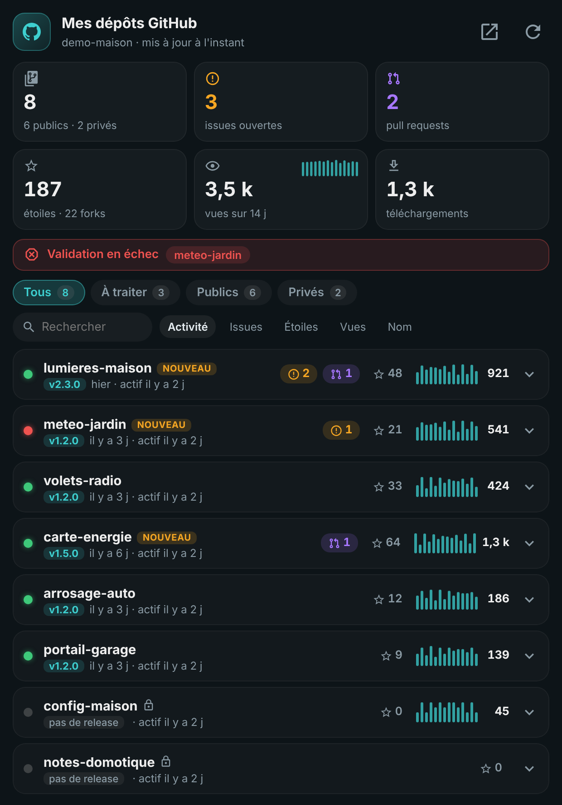
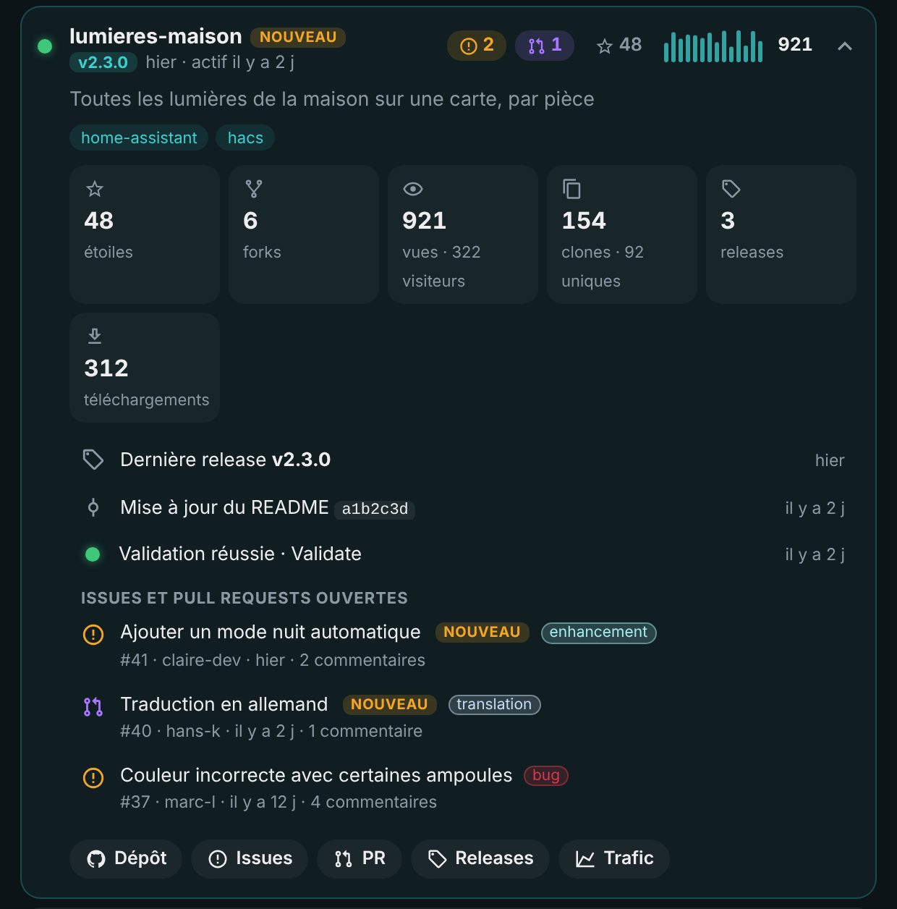

# 🐙 HOLM GitHub

[](https://hacs.xyz/)


[🇫🇷 Français](README.md) · 🇬🇧 English

**All your GitHub repos at a glance in Home Assistant: issues and pull requests to handle, latest releases, checks, stars, views and downloads.**

HOLM GitHub discovers **all the repos of your account**, public and private, from a single personal access token. No need to declare repos one by one: a new repo shows up on its own. The **HOLM GitHub** card, shipped with the integration, shows on one screen what needs your attention.

### At a glance

- 🗂️ **All the account's repos**, public and private; forks, archives and chosen repos can be excluded.
- 🐞 **Open issues and pull requests**: titles, labels, authors, comments, and a “new” tag for 7 days.
- 🏷️ **Releases**: latest version and its date, number of releases, downloads of attached files.
- ✅ **Checks**: state of the last GitHub Actions run (HACS validation for instance), with an alert on failure.
- 📈 **Audience**: stars, forks, and traffic over the last 14 days (views, unique visitors, clones) with mini charts.
- 🔔 **Notifications**: an event for each new issue or pull request, for your automations.
- 🪶 **Thrifty**: conditional requests (unchanged data doesn't use GitHub quota), traffic read once an hour.
- 🌍 **8 languages**: English, French, German, Spanish, Italian, Dutch, Portuguese and Polish (integration and card).

| The HOLM GitHub card | A repo's details |
|---|---|
|  |  |

<sub>Screenshots made with fictitious repos, in French — the card follows the language of your Home Assistant profile.</sub>

### 🆕 What's new in 1.1.0

- 🌍 **8 languages**: the integration (setup, options, entities, actions) is translated into English, French, German, Spanish, Italian, Dutch, Portuguese and Polish, following the language of Home Assistant. The **HOLM GitHub** card too, editor included; its `language` option lets you force a language.
- 🇬🇧 English README.

---

## Installation

### Via HACS (recommended)

1. HACS → ⋮ menu → **Custom repositories** → add `https://github.com/kaaribou/github-holm`, category **Integration**.
2. Search for **HOLM GitHub** and install.
3. Restart Home Assistant.

### Manually

Copy the `custom_components/github_holm` folder into the `custom_components` folder of your configuration, then restart Home Assistant.

## Creating the GitHub token

On GitHub: **Settings → Developer settings → Personal access tokens**.

- **Classic token** (*Tokens (classic)*): tick the **`repo`** scope. It is the simplest option: it gives access to private repos and traffic.
- **Fine-grained token**: *Repository access* → **All repositories**, then **read-only**: *Metadata*, *Contents*, *Issues*, *Pull requests*, *Actions* and *Administration* (the latter only for traffic).

Choose an expiry date: when it expires, Home Assistant will simply ask you for a new token.

> 🔒 The token is entered in Home Assistant and only used to read the GitHub API. It is redacted in the downloadable diagnostics.

## Configuration

Settings → Devices & services → **Add integration** → **HOLM GitHub**, then paste the token.

**Options**:

| Option | Role | Default |
|---|---|---|
| Update interval | How often repos are read | 15 min |
| Read traffic | Views and clones over 14 days | yes |
| Include forked repositories | | no |
| Include archived repositories | | no |
| Repositories to ignore | Comma-separated names | — |

## The HOLM GitHub card

Added automatically to the dashboard resources: just add the **HOLM GitHub** card.

```yaml
type: custom:holm-github-card
title: My GitHub repos
filter: todo        # all, todo, public, private
sort: activity      # activity, issues, stars, views, name
```

- **Key figures**: repos (public and private), issues, pull requests, stars and forks, views over 14 days with a mini chart, downloads.
- **Alert** when a check is failing.
- **Filters** All, To do, Public, Private, **search** and **sort** by activity, issues, stars, views or name.
- **One row per repo**: check light, version and date, issue and PR badges, stars, views over 14 days.
- **Expandable details**: description and topics, statistics, latest release, latest commit, checks, list of issues and PRs with labels, and shortcuts to the repo, issues, PRs, releases and traffic.

| Option | Description | Default |
|---|---|---|
| `title` | Title | `My GitHub repos` |
| `language` | Card language: `fr`, `en`, `de`, `es`, `it`, `nl`, `pt`, `pl` | the profile's |
| `filter` | Filter shown on opening | `all` |
| `sort` | Sort on opening | `activity` |
| `show_private` | Show private repos | `true` |
| `max_rows` | Number of repos shown before “Show all” (0 = all) | `0` |

The visual editor is available.

## Entities

| Sensor | Value |
|---|---|
| `sensor.github_<account>_depots` | Number of tracked repos (public and private as attributes) |
| `sensor.github_<account>_issues_ouvertes` | Open issues, per-repo details as an attribute |
| `sensor.github_<account>_pull_requests_ouvertes` | Open pull requests, per-repo details |
| `sensor.github_<account>_etoiles` / `_forks` | Total stars / forks |
| `sensor.github_<account>_vues_14_jours` / `_clones_14_jours` | Traffic over the last 14 days |
| `sensor.github_<account>_telechargements` | Downloads of release files |
| `sensor.github_<account>_quota_api_restant` | Requests left in the hour (diagnostic) |

*Entity IDs depend on the language Home Assistant had when the integration was added (French names shown here).*

**Action**: `github_holm.refresh` reads everything again immediately.

## Getting notified of a new issue

The `github_holm_new_item` event is fired for each new issue or pull request (`repo`, `type`, `number`, `title`, `url`, `user`):

```yaml
alias: GitHub – new issue
triggers:
  - trigger: event
    event_type: github_holm_new_item
actions:
  - action: notify.mobile_app_my_phone
    data:
      title: "{{ trigger.event.data.repo }}: new {{ 'PR' if trigger.event.data.type == 'pull_request' else 'issue' }}"
      message: "#{{ trigger.event.data.number }} {{ trigger.event.data.title }}"
      data:
        url: "{{ trigger.event.data.url }}"
```

## FAQ

**No traffic for some repos.** GitHub only gives traffic to accounts that can write to the repo, and the token needs the `repo` scope (or read access to *Administration* for a fine-grained token).

**API quota.** With a token, GitHub allows 5,000 requests per hour. An update costs about 4 requests per repo, and unchanged data doesn't count: even with 50 repos, you stay far from the limit.

**The number of issues differs from GitHub.** GitHub counts issues and pull requests together; HOLM GitHub separates them.

> Not affiliated with GitHub.

---

## Say thanks?

Like the integration? You can buy me a beer 🍺

[](https://paypal.me/kaaribou)

---

## License

Code: **MIT** license — © kaaribou. See the [CHANGELOG](CHANGELOG.md) (in French).

Part of **HOLM — Home Orchestration & Living Management**: smart management and orchestration of the home.

Other projects: [Carburant HOLM](https://github.com/kaaribou/carburant-holm) · [Climat HOLM](https://github.com/kaaribou/climat-holm) · [Volets HOLM](https://github.com/kaaribou/volets-holm) · [HOLM HP/HC](https://github.com/kaaribou/holm-tarif) · [HOLM Lektrico](https://github.com/kaaribou/lektrico-holm) · [HOLM LaMetric](https://github.com/kaaribou/lametric-holm) · [HOLM My Menu](https://github.com/kaaribou/holm-mymenu) · [HOLM Cars](https://github.com/kaaribou/holm-cars) · [HOLM Navbar Card](https://github.com/kaaribou/holm-navbar-card) · [HOLM Climate Card](https://github.com/kaaribou/climate-card-holm) · [HOLM Music Card](https://github.com/kaaribou/holm-music-card) · [HOLM Energy Cards](https://github.com/kaaribou/holm-energy-cards) · [HOLM Power Flow Card](https://github.com/kaaribou/holm-power-flow-card) · [HOLM Ecojoko Card](https://github.com/kaaribou/holm-ecojoko-card) · [HOLM Runtime Card](https://github.com/kaaribou/holm-runtime-card) · [HOLM Covers Card](https://github.com/kaaribou/holm-covers-card) · [HOLM Floor Card](https://github.com/kaaribou/holm-floor-card) · [HOLM Radiator Card](https://github.com/kaaribou/holm-radiator-card) · [HOLM Security Card](https://github.com/kaaribou/holm-security-card) · [HOLM Sentinel Card](https://github.com/kaaribou/holm-sentinel-card) · [HOLM Recordings Card](https://github.com/kaaribou/holm-recordings-card) · [HOLM Smoke Card](https://github.com/kaaribou/holm-smoke-card) · [HOLM Family Card](https://github.com/kaaribou/holm-family-card) · [HOLM Govee Light Card](https://github.com/kaaribou/holm-govee-light-card) · [HOLM Leapmotor Card](https://github.com/kaaribou/holm-leapmotor-card).
