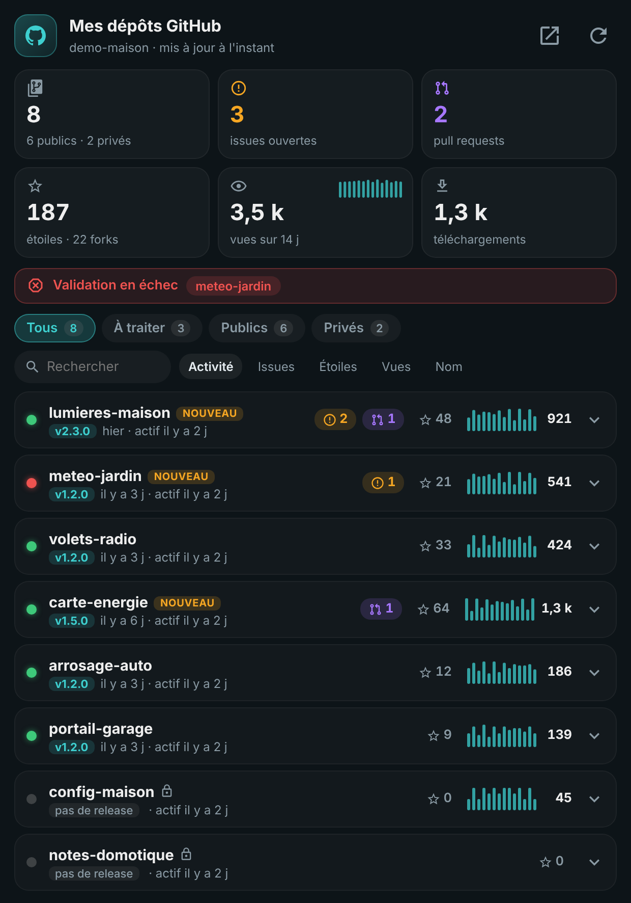
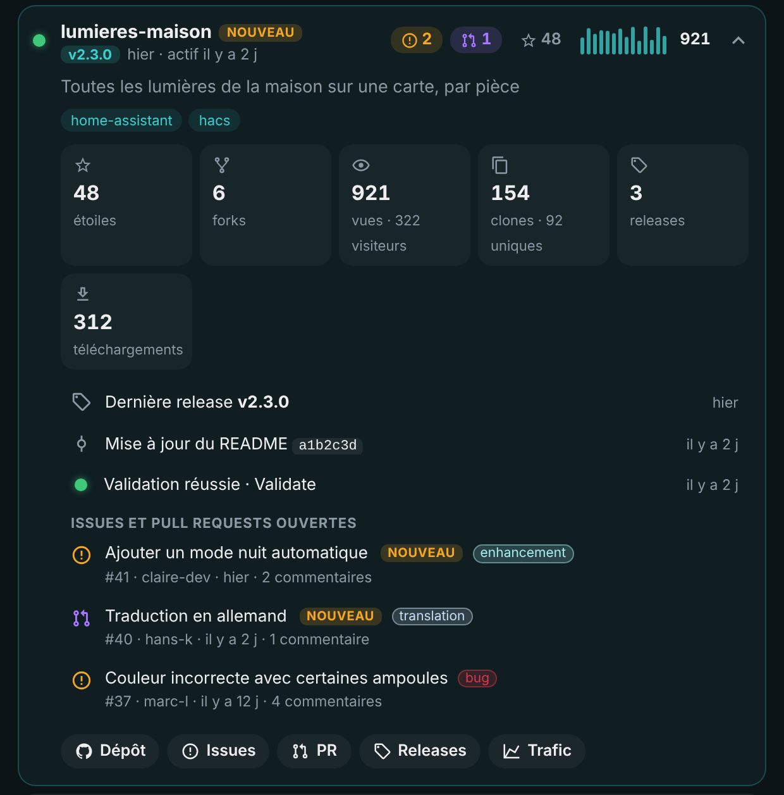
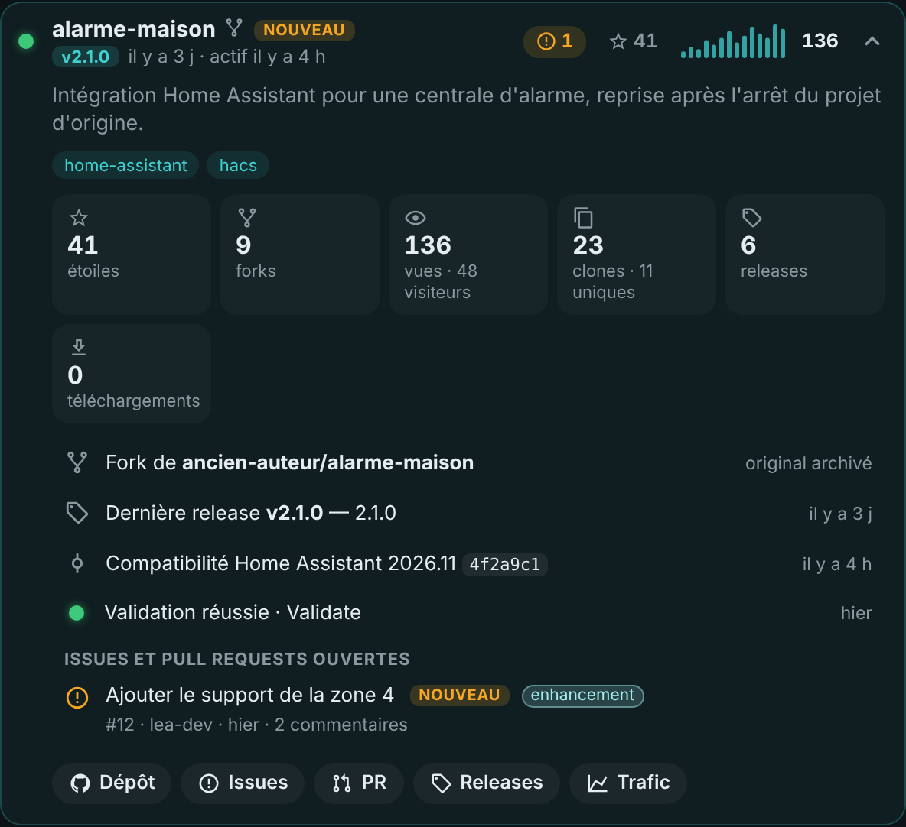

# 🐙 HOLM GitHub

[](https://hacs.xyz/)


🇫🇷 Français · [🇬🇧 English](README.en.md)

**Tous vos dépôts GitHub d'un coup d'œil dans Home Assistant : issues et pull requests à traiter, dernières releases, validation, étoiles, vues et téléchargements.**

HOLM GitHub découvre **tous les dépôts de votre compte**, publics et privés, à partir d'un simple jeton d'accès personnel. Pas besoin de déclarer les dépôts un par un : un nouveau dépôt apparaît tout seul. La carte **HOLM GitHub**, fournie avec l'intégration, montre en un écran ce qui demande votre attention.

### En bref

- 🗂️ **Tous les dépôts du compte**, publics et privés ; forks, archives et dépôts choisis peuvent être inclus ou exclus.
- 🍴 **Les forks que vous avez repris** (dont l'original est archivé) apparaissent tout seuls, avec l'original indiqué.
- 🐞 **Issues et pull requests ouvertes** : titres, étiquettes, auteurs, commentaires, et la mention « nouveau » pendant 7 jours.
- 🏷️ **Releases** : dernière version et sa date, nombre de releases, téléchargements des fichiers attachés.
- ✅ **Validation** : état du dernier passage GitHub Actions (validation HACS par exemple), avec alerte en cas d'échec.
- 📈 **Audience** : étoiles, forks, et trafic des 14 derniers jours (vues, visiteurs uniques, clones) avec mini-graphiques.
- 🔔 **Notifications** : un évènement à chaque nouvelle issue ou pull request, pour vos automatisations.
- 🪶 **Économe** : requêtes conditionnelles (une donnée inchangée ne consomme pas le quota GitHub), trafic relu une fois par heure.

| La carte HOLM GitHub | Le détail d'un dépôt |
|---|---|
|  |  |

<sub>Captures réalisées avec des dépôts fictifs.</sub>


### 🆕 Nouveautés de la 1.2.0

- 🍴 **Forks repris** (merci à AuroreVgn pour l'idée) : quand le dépôt d'origine d'un de vos forks est **archivé**, c'est que vous avez sans doute repris le projet. Ce fork est désormais affiché, comme vos propres dépôts, sans avoir à inclure tous vos forks. Option **Inclure les forks dont l'original est archivé**, activée par défaut. Voir [Forks et dépôts archivés](#forks-et-dépôts-archivés).
- 📌 **Dépôts toujours affichés** : une liste de noms affichés quoi qu'il arrive, même forks ou archivés, le pendant de « Dépôts à ignorer ».
- 🔗 **L'original d'un fork sur la carte** : une icône 🍴 à côté du nom, et dans le détail une ligne « Fork de propriétaire/dépôt » vers l'original, avec la mention « original archivé » le cas échéant.



### Nouveautés de la 1.1.0

- 🌍 **8 langues** : l'intégration (configuration, options, entités, actions) est traduite en français, anglais, allemand, espagnol, italien, néerlandais, portugais et polonais, selon la langue de Home Assistant. La carte **HOLM GitHub** aussi, éditeur compris ; son option `language` permet d'imposer une langue.
- 🇬🇧 README en anglais.

---

## Installation

### Via HACS (recommandé)

1. HACS → menu ⋮ → **Dépôts personnalisés** → ajoutez `https://github.com/kaaribou/github-holm`, catégorie **Intégration**.
2. Recherchez **HOLM GitHub** et installez.
3. Redémarrez Home Assistant.

### Manuelle

Copiez le dossier `custom_components/github_holm` dans le dossier `custom_components` de votre configuration, puis redémarrez Home Assistant.

## Créer le jeton GitHub

Sur GitHub : **Settings → Developer settings → Personal access tokens**.

- **Jeton classique** (*Tokens (classic)*) : cochez la portée **`repo`**. C'est la solution la plus simple : elle donne accès aux dépôts privés et au trafic.
- **Jeton à granularité fine** (*Fine-grained tokens*) : *Repository access* → **All repositories**, puis en **lecture seule** : *Metadata*, *Contents*, *Issues*, *Pull requests*, *Actions* et *Administration* (cette dernière uniquement pour le trafic).

Choisissez une date d'expiration : à l'échéance, Home Assistant vous demandera simplement un nouveau jeton.

> 🔒 Le jeton est saisi dans Home Assistant et n'est utilisé que pour lire l'API GitHub. Il est masqué dans le diagnostic téléchargeable.

## Configuration

Paramètres → Appareils et services → **Ajouter une intégration** → **HOLM GitHub**, puis collez le jeton.

**Options** :

| Option | Rôle | Par défaut |
|---|---|---|
| Intervalle de mise à jour | Fréquence de lecture des dépôts | 15 min |
| Lire le trafic | Vues et clones sur 14 jours | oui |
| Inclure les forks dont l'original est archivé | Affiche les forks que vous avez repris (voir ci-dessous) | oui |
| Inclure les dépôts forkés | Affiche **tous** vos forks, y compris ceux faits pour proposer une pull request | non |
| Inclure les dépôts archivés | Affiche vos propres dépôts archivés (grisés sur la carte) | non |
| Dépôts toujours affichés | Noms séparés par des virgules, affichés quoi qu'il arrive | — |
| Dépôts à ignorer | Noms séparés par des virgules, jamais affichés | — |

Dans les deux listes, un dépôt s'écrit par son nom (`somfy-protexial`) ou avec son propriétaire (`kaaribou/somfy-protexial`), sans tenir compte des majuscules.

### Forks et dépôts archivés

Par défaut, HOLM GitHub montre vos propres dépôts et laisse de côté les forks et les dépôts archivés. Pour chaque dépôt, la règle est appliquée dans cet ordre :

1. **Dépôts à ignorer** : jamais affiché, même s'il figure dans la liste suivante.
2. **Dépôts toujours affichés** : affiché, même fork ou archivé.
3. **Dépôt archivé** : affiché seulement si **Inclure les dépôts archivés** est cochée.
4. **Fork** : affiché si **Inclure les dépôts forkés** est cochée ; sinon, affiché seulement si son original est archivé et que **Inclure les forks dont l'original est archivé** est cochée.
5. Tous les autres dépôts sont affichés.

**Pourquoi « l'original est archivé » ?** Quand l'auteur d'un projet l'archive, il ne le maintient plus. Si vous en avez un fork, c'est souvent vous qui avez repris le flambeau : votre fork est devenu le dépôt principal. À l'inverse, un fork d'un projet toujours actif sert en général à proposer une pull request, et n'a pas sa place parmi vos projets.

Pour savoir si l'original est archivé, HOLM GitHub fait **une requête par fork, une fois par jour** : c'est négligeable par rapport au quota GitHub. Décochez l'option si vous ne voulez aucun fork : plus aucune requête n'est faite pour eux.

## La carte HOLM GitHub

Ajoutée automatiquement aux ressources du tableau de bord : ajoutez simplement la carte **HOLM GitHub**.

```yaml
type: custom:holm-github-card
title: Mes dépôts GitHub
filter: todo        # all, todo (à traiter), public, private
sort: activity      # activity, issues, stars, views, name
```

- **Chiffres clés** : dépôts (publics et privés), issues, pull requests, étoiles et forks, vues sur 14 jours avec mini-graphique, téléchargements.
- **Alerte** quand une validation est en échec.
- **Filtres** Tous, À traiter, Publics, Privés, **recherche** et **tri** par activité, issues, étoiles, vues ou nom.
- **Une ligne par dépôt** : voyant de validation, version et date, badges issues et PR, étoiles, vues sur 14 jours.
- **Icônes à côté du nom** : 🔒 dépôt privé, 🍴 fork (au survol : « Fork de propriétaire/dépôt »). Un dépôt archivé apparaît grisé.
- **Détail dépliable** : description et sujets, statistiques, pour un fork la ligne **Fork de propriétaire/dépôt** (lien vers l'original, avec la mention « original archivé » si c'est le cas), dernière release, dernier commit, validation, liste des issues et PR avec étiquettes, et raccourcis vers le dépôt, les issues, les PR, les releases et le trafic.

| Option | Description | Par défaut |
|---|---|---|
| `title` | Titre | `Mes dépôts GitHub` |
| `language` | Langue de la carte : `fr`, `en`, `de`, `es`, `it`, `nl`, `pt`, `pl` | celle du profil |
| `filter` | Filtre affiché à l'ouverture | `all` |
| `sort` | Tri à l'ouverture | `activity` |
| `show_private` | Afficher les dépôts privés | `true` |
| `max_rows` | Nombre de dépôts affichés avant « Voir tout » (0 = tous) | `0` |

L'éditeur visuel est disponible.

## Entités

| Capteur | Valeur |
|---|---|
| `sensor.github_<compte>_depots` | Nombre de dépôts suivis (publics et privés en attributs) |
| `sensor.github_<compte>_issues_ouvertes` | Issues ouvertes, détail par dépôt en attribut |
| `sensor.github_<compte>_pull_requests_ouvertes` | Pull requests ouvertes, détail par dépôt |
| `sensor.github_<compte>_etoiles` / `_forks` | Total des étoiles / forks |
| `sensor.github_<compte>_vues_14_jours` / `_clones_14_jours` | Trafic des 14 derniers jours |
| `sensor.github_<compte>_telechargements` | Téléchargements des fichiers de release |
| `sensor.github_<compte>_quota_api_restant` | Requêtes restantes dans l'heure (diagnostic) |

**Action** : `github_holm.refresh` relit tout immédiatement.

## Être prévenu d'une nouvelle issue

L'évènement `github_holm_new_item` est émis pour chaque nouvelle issue ou pull request (`repo`, `type`, `number`, `title`, `url`, `user`) :

```yaml
alias: GitHub – nouvelle issue
triggers:
  - trigger: event
    event_type: github_holm_new_item
actions:
  - action: notify.mobile_app_mon_telephone
    data:
      title: "{{ trigger.event.data.repo }} : nouvelle {{ 'PR' if trigger.event.data.type == 'pull_request' else 'issue' }}"
      message: "#{{ trigger.event.data.number }} {{ trigger.event.data.title }}"
      data:
        url: "{{ trigger.event.data.url }}"
```

## FAQ

**Pas de trafic pour certains dépôts.** GitHub ne donne le trafic qu'aux comptes qui peuvent écrire dans le dépôt, et le jeton doit avoir la portée `repo` (ou *Administration* en lecture pour un jeton à granularité fine).

**Le quota d'API.** Avec un jeton, GitHub autorise 5 000 requêtes par heure. Une mise à jour coûte environ 4 requêtes par dépôt, et les données inchangées ne comptent pas : même avec 50 dépôts, on reste loin de la limite.

**Un de mes forks n'apparaît pas.** Seuls les forks dont l'original est archivé sont affichés automatiquement. Ajoutez son nom dans **Dépôts toujours affichés**, ou cochez **Inclure les dépôts forkés** pour les voir tous.

**Un fork apparaît alors que je ne le veux pas.** Ajoutez son nom dans **Dépôts à ignorer**, ou décochez **Inclure les forks dont l'original est archivé**.

**Le nombre d'issues diffère de GitHub.** GitHub compte ensemble issues et pull requests ; HOLM GitHub les sépare.

---

Fait partie de **HOLM — Home Orchestration & Living Management** : la gestion et l'orchestration intelligente de la maison.

Les autres projets : [Volets HOLM](https://github.com/kaaribou/volets-holm) · [Climat HOLM](https://github.com/kaaribou/climat-holm) · [Carburant HOLM](https://github.com/kaaribou/carburant-holm) · [Commandes à la maison HOLM](https://github.com/kaaribou/commandes-holm) · [HOLM LaMetric](https://github.com/kaaribou/lametric-holm) · [HOLM My Menu](https://github.com/kaaribou/holm-mymenu) · [HOLM Lektrico](https://github.com/kaaribou/lektrico-holm) · [HOLM Navbar Card](https://github.com/kaaribou/holm-navbar-card) · [HOLM Climate Card](https://github.com/kaaribou/climate-card-holm) · [HOLM Music Card](https://github.com/kaaribou/holm-music-card) · [HOLM Sentinel Card](https://github.com/kaaribou/holm-sentinel-card) · [HOLM Security Card](https://github.com/kaaribou/holm-security-card) · [HOLM Recordings Card](https://github.com/kaaribou/holm-recordings-card) · [HOLM Covers Card](https://github.com/kaaribou/holm-covers-card) · [HOLM Runtime Card](https://github.com/kaaribou/holm-runtime-card) · [HOLM Power Flow Card](https://github.com/kaaribou/holm-power-flow-card) · [HOLM Energy Cards](https://github.com/kaaribou/holm-energy-cards) · [HOLM Radiator Card](https://github.com/kaaribou/holm-radiator-card) · [HOLM Floor Card](https://github.com/kaaribou/holm-floor-card) · [HOLM Ecojoko Card](https://github.com/kaaribou/holm-ecojoko-card) · [HOLM Smoke Card](https://github.com/kaaribou/holm-smoke-card) · [HOLM BG Card](https://github.com/kaaribou/holm-bg-card).

Licence MIT · Non affilié à GitHub. · [☕ Offrir une bière](https://paypal.me/kaaribou)
